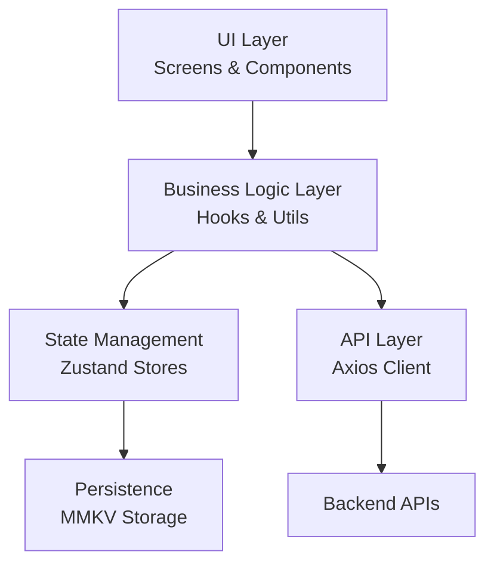
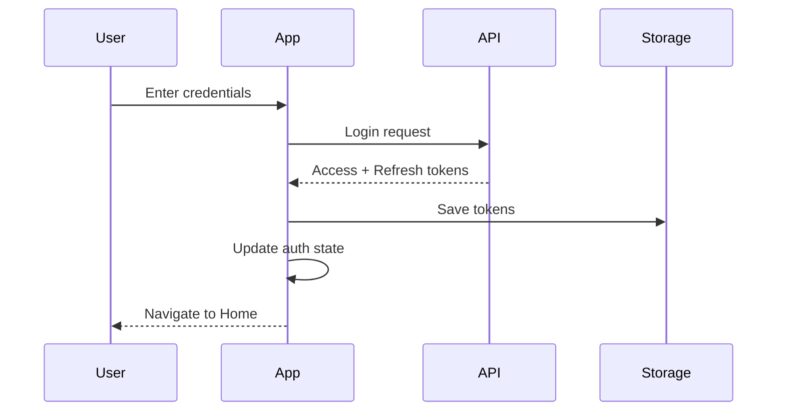

# Project Architecture

This document provides an overview of the technical architecture and design patterns used in this React Native application.

## 🏗️ Architecture Overview

The application follows a **modular, feature-based architecture** with clear separation of concerns.



## 📂 Folder Structure

### Core Directories

#### `/src/components`
Reusable UI components organized by category:
- `forms/` - Form-related components (inputs, selects, etc.)
- `layout/` - Layout components (headers, containers, etc.)
- `navigation/` - Navigation-related components (tab bars, drawers)
- `ui/` - Basic UI primitives (buttons, cards, modals)

**Pattern**: Components should be pure and reusable

#### `/src/screens`
Screen-level components organized by feature:
- `auth/` - Authentication screens
- `home/` - Home and dashboard screens
- One screen = One file/folder

**Pattern**: Screens compose components and connect to stores

#### `/src/navigation`
Navigation configuration using React Navigation:
- `index.tsx` - Root navigator setup
- `types.ts` - Navigation type definitions
- `linking.ts` - Deep linking configuration

**Pattern**: Type-safe navigation with proper typing

#### `/src/store`
State management using Zustand:
- `index.ts` - Store exports
- `slices/` - Individual store slices by feature

**Pattern**: Modular stores with MMKV persistence

#### `/src/api`
API integration layer:
- `client.ts` - Axios instance with interceptors
- `endpoints/` - API endpoint definitions

**Pattern**: Centralized API configuration with typed requests

#### `/src/hooks`
Custom React hooks:
- Domain hooks (e.g., `useApi`, `useAuth`)
- Utility hooks (e.g., `useDebounce`, `useKeyboard`)

**Pattern**: Reusable logic extraction

#### `/src/utils`
Pure utility functions:
- `formatters.ts` - Data formatting
- `validators.ts` - Validation functions
- `logger.ts` - Logging utilities
- `storage.ts` - Storage wrapper

**Pattern**: Stateless, testable functions

#### `/src/config`
Application configuration:
- `env.ts` - Environment variables
- `theme.ts` - Theme configuration
- `constants.ts` - App-wide constants

**Pattern**: Centralized configuration

## 🔄 Data Flow

### 1. State Management (Zustand)

```typescript
// Define store
export const useAuthStore = create<AuthState>()(
  persist(
    (set) => ({
      user: null,
      login: async (credentials) => {
        const user = await api.auth.login(credentials);
        set({ user });
      },
    }),
    { name: 'auth-storage' }
  )
);

// Use in component
const { user, login } = useAuthStore();
```

**Benefits**:
- Simple, hook-based API
- No boilerplate
- Built-in persistence with MMKV
- TypeScript support

### 2. API Integration

```typescript
// API client with interceptors
const apiClient = axios.create({
  baseURL: Config.API_URL,
  timeout: 15000,
});

// Request interceptor
apiClient.interceptors.request.use(async (config) => {
  const token = Storage.getString('access_token');
  if (token) {
    config.headers.Authorization = `Bearer ${token}`;
  }
  return config;
});

// Response interceptor
apiClient.interceptors.response.use(
  (response) => response,
  async (error) => {
    // Handle 401, refresh tokens, etc.
  }
);
```

**Benefits**:
- Automatic token management
- Centralized error handling
- Request/response transformation

### 3. Navigation

```typescript
// Type-safe navigation
type RootStackParamList = {
  Home: undefined;
  Profile: { userId: string };
};

// In component
const navigation = useNavigation<NavigationProp<RootStackParamList>>();
navigation.navigate('Profile', { userId: '123' });
```

**Benefits**:
- Type safety
- Autocomplete
- Compile-time error checking

## 🎨 Theming

### Theme Structure

```typescript
export interface Theme {
  colors: {
    primary: string;
    background: string;
    text: string;
    // ...
  };
  typography: {
    fontSize: { ... };
    fontWeight: { ... };
  };
  spacing: { ... };
  shadows: { ... };
}
```

### Usage

```typescript
import { useUIStore } from '@store';
import { lightTheme, darkTheme } from '@config/theme';

const { theme } = useUIStore();
const currentTheme = theme === 'dark' ? darkTheme : lightTheme;
```

## 🔐 Authentication Flow



## 📡 Network Handling

```typescript
// Network status hook
const { isConnected, isInternetReachable } = useNetworkStatus();

// Conditional rendering
if (!isConnected) {
  return <OfflineScreen />;
}
```

## 🧪 Testing Strategy

### Unit Tests
- Utils and pure functions
- Custom hooks
- Store actions/selectors

### Integration Tests
- Component + Store interactions
- API client + Mock server
- Navigation flows

### E2E Tests (Optional)
- Critical user flows
- Using Detox or Appium

## 🚀 Performance Optimizations

### 1. List Rendering
```typescript
// Use FlashList instead of FlatList
import { FlashList } from '@shopify/flash-list';

<FlashList
  data={items}
  renderItem={({ item }) => <Item {...item} />}
  estimatedItemSize={100}
/>
```

### 2. Image Optimization
```typescript
// Use FastImage for better performance
import FastImage from 'react-native-fast-image';

<FastImage
  source={{ uri: imageUrl }}
  resizeMode={FastImage.resizeMode.cover}
/>
```

### 3. Memoization
```typescript
// Memoize expensive computations
const expensiveValue = useMemo(() => 
  computeExpensiveValue(data), 
  [data]
);

// Memoize callbacks
const handlePress = useCallback(() => {
  doSomething(id);
}, [id]);
```

## 📦 Bundle Size Management

- Tree shaking enabled
- Code splitting by route
- Lazy loading for heavy screens
- Asset optimization (images, fonts)

## 🔒 Security Best Practices

1. **Secure Storage**: Use MMKV for sensitive data
2. **Token Management**: Auto-refresh, secure transmission
3. **Environment Variables**: Never commit secrets
4. **Input Validation**: Validate all user inputs
5. **SSL Pinning**: For production apps (optional)

## 📱 Platform-Specific Code

```typescript
import { Platform } from 'react-native';

// Platform-specific values
const padding = Platform.select({
  ios: 20,
  android: 16,
  default: 16,
});

// Platform-specific files
// Button.ios.tsx
// Button.android.tsx
```

## 🎯 Design Patterns

### 1. Container-Presenter Pattern
```typescript
// Container (smart component)
const ProfileContainer = () => {
  const { user } = useAuthStore();
  const { data, isLoading } = useApi('/profile');
  
  return <ProfileView user={user} data={data} loading={isLoading} />;
};

// Presenter (dumb component)
const ProfileView = ({ user, data, loading }) => {
  // Pure rendering logic
};
```

### 2. Custom Hooks Pattern
```typescript
// Extract reusable logic
const useFormValidation = (schema) => {
  const [errors, setErrors] = useState({});
  
  const validate = (values) => {
    // Validation logic
  };
  
  return { errors, validate };
};
```

### 3. Higher-Order Components (HOC)
```typescript
// Add functionality to components
const withAuth = (Component) => {
  return (props) => {
    const { isAuthenticated } = useAuthStore();
    
    if (!isAuthenticated) {
      return <LoginScreen />;
    }
    
    return <Component {...props} />;
  };
};
```

## 🔧 Development Tools

- **Reactotron**: State inspection and debugging
- **Flipper**: Native debugging and inspection
- **ESLint**: Code quality
- **TypeScript**: Type safety
- **Husky**: Git hooks

## 📚 Further Reading

- [React Native Best Practices](https://reactnative.dev/docs/performance)
- [React Navigation Docs](https://reactnavigation.org/)
- [Zustand Documentation](https://github.com/pmndrs/zustand)
- [TypeScript Handbook](https://www.typescriptlang.org/docs/)
