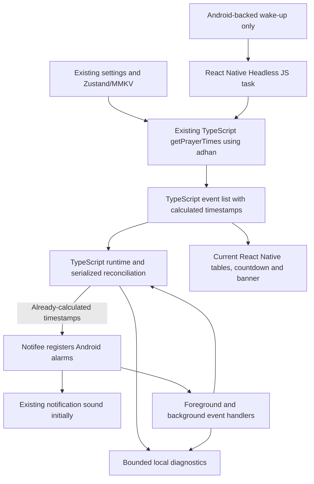

# React Native kiosk reliability — implementation plan

Date: 2026-11-10  
Status: Proposed. Documentation only; application changes await explicit approval.  
Architecture: React Native and TypeScript, retaining the existing `adhan` package, Zustand/MMKV and Notifee.

**Required boundary: all prayer-time and iqama-time calculations stay in TypeScript. Both foreground and background calculation call the existing `src/utils/prayer.ts` and `adhan` package. Android receives already-calculated timestamps through Notifee; no Kotlin/Java prayer calculation is included.**

## 1. Scope and intended result

Fix the adhan/iqama sound failures and the red “close your phone” banner moving to the top during continuous kiosk operation.

Keep prayer calculation, configuration, scheduling policy, recovery logic and presentation in TypeScript. Use the Android capabilities exposed by React Native libraries for alarms, background execution and, if needed, dedicated audio playback.

Preserve all calibrated UI dimensions, fonts, scaling helpers, spacing, backgrounds, card geometry and banner height. Preserve local audio assets and offline operation. The existing prayer calculation method, adjustments and iqama delays remain authoritative.

Native manifest/configuration changes may still be necessary. A small Android integration is a fallback only if the selected libraries cannot provide a verified background wake-up or playback path. It must not move prayer calculations or application policy out of TypeScript.

Existing uncommitted changes in `App.tsx`, `src/constants/athker.ts` and `src/store/prayerStore.ts` predate this plan. Preserve them during future implementation.

## 2. What is known and what remains open

### Confirmed observations

- The app runs on an Android box connected to a monitor with speakers.
- After approximately three days, sound stops while the visible app continues operating normally.
- The displaced element is the red in-app banner, not an Android notification popup.
- There is no evidence that the TypeScript prayer calculation package is causing either failure.

### Confirmed code risks

| Finding | File | Required correction |
| --- | --- | --- |
| Minute refresh recalculates UI data and schedules notifications together | `src/screens/PrayerHomeScreen.tsx` | Separate presentation updates from scheduling. |
| Every scheduling pass cancels every pending notification first | `src/services/notifications.ts` | Reconcile individual changes and preserve unchanged alerts. |
| Countdown expiry invokes the same scheduling refresh | `src/components/prayer-card/CurrentPrayCard.tsx` | Make countdown expiry presentation-only. |
| Today/tomorrow scheduling depends on the home screen | `src/screens/PrayerHomeScreen.tsx` | Add application-level maintenance and background renewal. |
| Installed Notifee 9.1.8 defaults to WorkManager; triggers omit AlarmManager configuration | `src/services/notifications.ts` | Configure exact alarms and check runtime access. |
| Sound is supplied by Android notification channels | `src/services/notifications.ts` | Diagnose channel/delivery/output state; add managed playback only if needed. |
| Manual timezone shifts UI timestamps but is disabled for notification calculations | `src/utils/prayer.ts` | Separate real event instants from display formatting. |
| Banner animation has no explicit cleanup and reads private Animated state | `src/components/notification-banner/NotificationBanner.tsx` | Add cleanup, reset animations and use public lifecycle state. |
| MMKV initialization can fall back to in-memory storage | `src/utils/mmkv.ts` | Report persistence failure; never claim restart recovery is healthy in fallback mode. |

The due-time cancellation race is concrete: countdown expiry can cancel an alert before Android delivers it, and rebuilding then omits it because its timestamp is past. These findings do not establish the exact cause of the three-day silence or banner displacement.

### Questions retained until the user supplies answers

1. Android box manufacturer/model, Android version and firmware/build.
2. Whether restarting only the app restores audio, or a box/monitor restart is required.
3. Box-to-monitor connection: HDMI or another route.
4. Whether another app can still play sound through the monitor during the failure.
5. Whether Android adhan/iqama notifications still arrive silently when sound stops.
6. Whether the monitor enters standby, turns off or reconnects during normal use.
7. Current kiosk launcher/power configuration and the version of the APK installed on the box.

These questions do not prevent TypeScript design or isolated fixes. They determine the final alarm mode, audio diagnosis and hardware acceptance tests.

## 3. Target design

### Calculation ownership

| Operation | Where it runs | Implementation |
| --- | --- | --- |
| Calculate prayer times | React Native JavaScript runtime | Existing TypeScript `getPrayerTimes` using `adhan`. |
| Calculate iqama times | React Native JavaScript runtime | Existing TypeScript prayer time plus configured iqama delay. |
| Calculate future days while Home is closed | React Native Headless JS runtime | The same TypeScript functions and package; no second calculation implementation. |
| Decide which events need scheduling | TypeScript runtime service | Compare calculated events with persisted/pending events. |
| Register and fire a timestamp alarm | Notifee's Android implementation | Receive the timestamp calculated in TypeScript and register it with Android. |
| Wake a background task | Android-backed library/integration | Start the JavaScript task; it does not calculate prayer times. |

If diagnostics establish a need for dedicated playback, replace the sound branch with a verified native-backed React Native audio library controlled by a TypeScript playback coordinator. There must be one sound owner per event.

### Proposed TypeScript files

| File | Responsibility |
| --- | --- |
| `src/services/prayerSchedule.ts` | Pure schedule builder using existing `getPrayerTimes`/`adhan`; return dated canonical events. |
| `src/services/prayerRuntime.ts` | Initialize once, observe configuration, serialize refresh requests and coordinate recovery. |
| `src/services/prayerScheduleStorage.ts` | Persist desired schedule, schema/revision, reconciliation progress and event observations in existing MMKV. |
| `src/services/prayerBackground.ts` | Register Notifee event handling and the background renewal entry point without importing UI. |
| `src/services/prayerDiagnostics.ts` | Record bounded scheduling/delivery/health history and expose operator export. |
| `src/hooks/usePrayerPresentation.ts` | Derive countdown, current/next prayer and banner visibility from schedule and current time. |
| `src/types/prayerRuntime.ts` | Event, configuration snapshot, reconciliation, health and diagnostic contracts. |
| `src/services/prayerAudio.ts` — conditional | Single-player lifecycle and duplicate handling if a dedicated audio library is needed. |

### Existing files to update after approval

- `src/services/notifications.ts`: keep as the Notifee adapter; create channels at initialization, select exact alarm mode, expose pending-trigger reads and per-ID updates/cancellations.
- `src/utils/prayer.ts`: retain calculation implementation; isolate formatting/timezone concerns and support explicit clock input for presentation tests.
- `src/screens/PrayerHomeScreen.tsx`: render schedule/presentation state; remove scheduling from minute refresh and countdown callbacks.
- `src/components/prayer-card/CurrentPrayCard.tsx`: stop scheduling side effects and repeated expiration callbacks.
- `src/components/notification-banner/NotificationBanner.tsx`: stabilize bottom anchor and clean up animation lifecycle.
- `src/store/prayerStore.ts`: preserve persisted settings; expose ready/validated configuration and changes without replacing saved values with defaults.
- `src/utils/mmkv.ts`: make persistence health observable to the runtime and verify the adapter works in Headless JS.
- `App.tsx`: initialize/dispose application-level observers once after settings are ready.
- `index.js`: register the single Notifee background handler and any headless/service callbacks early, outside components.
- `src/screens/PrayerSettingsScreen.tsx`: only if needed for operator diagnostics, permission repair and sound testing; leave the public prayer display unchanged.
- Android manifest, `BootReceiver.kt`, Gradle and package dependencies: only the configuration or small lifecycle integration proven necessary by the capability checks below.

Keep the existing calculation package and storage. Keep platform-specific scheduling behavior behind an adapter so existing iOS behavior is not accidentally changed.

## 4. Scheduling contract

### Canonical events and settings

Build events with `id`, local prayer date, prayer name, kind (`adhan` or `iqama`), UTC `scheduledAt`, configuration revision and sound key. Use stable full-date IDs such as `prayer/2026-11-10/fajr/adhan`; revision is separate from identity.

Keep the current `adhan` version during the reliability work. Validate finite coordinates, supported methods, numeric adjustments and iqama delays before scheduling. Load persisted settings before building the first schedule, including in background tasks.

Use the same real timestamp for the countdown, banner and alert. Treat display timezone formatting separately. Before changing enabled manual-timezone configurations, establish whether the option means display formatting or an intentional correction to prayer time. Preserve existing valid prayer times and verify any correction explicitly. Use an explicit timezone policy for date boundaries and DST; a fixed UTC offset must not silently stand in for a named timezone.

### Reconcile instead of cancel-and-rebuild

1. Request reconciliation on initialization, configuration change, day rollover, resume, detected clock/timezone change or background renewal.
2. Coalesce concurrent requests through a single runtime queue; recheck the latest configuration revision before applying results.
3. In TypeScript, call the existing `getPrayerTimes`/`adhan` functions for today plus the next two local days: at most 30 prayer alerts. Keep yesterday's events available for presentation around midnight. Pass the resulting timestamps to Notifee; Android does not recalculate them.
4. Read the actual pending Notifee triggers, compare IDs/timestamps/configuration and preserve unchanged events.
5. Create/update missing or changed future events. Cancel obsolete prayer IDs individually. Do not call global cancellation during routine operation.
6. Never remove a due event just because it disappeared from the future-only calculation. Preserve it through the due-time grace window, then clean up after reconciling observed delivery state.
7. Save desired/applied revisions, coverage and errors. If the process dies halfway through, reconcile persisted intent against actual Notifee state at the next wake-up.

Notifee documents a 50 active timestamp-trigger limit. Keep the proposed 30-alert window below that limit, account for unrelated triggers and temporary migration overlap, and defer noncritical additions rather than clear the queue. The three-day window is a buffer, not a substitute for renewal. See [Notifee triggers](https://notifee.app/react-native/docs/triggers/).

Local persistence and Android trigger registration are not one atomic operation. MMKV multi-process mode also does not make a JavaScript read/check/write sequence a cross-runtime transaction. Keep foreground and headless entry points on one verified runtime/serialized writer. If testing exposes simultaneous runtimes, add the smallest supported locking/coordinator mechanism before relying on delivery claims.

### Exact-alarm configuration

Use the installed Notifee `alarmManager.type` API with an explicit exact mode, initially evaluating `AlarmType.SET_EXACT_AND_ALLOW_WHILE_IDLE`. Check the actual installed API and exact-alarm access before scheduling. Notification permission and exact-alarm permission are separate checks.

Idle alarms can be throttled, particularly relevant to the five-minute Maghrib-to-iqama interval. Validate this on the box and evaluate `SET_ALARM_CLOCK` if the required standby behavior demands it, including its system-visible effects. Do not silently report approximate scheduling as healthy. See [Android alarm guidance](https://developer.android.com/develop/background-work/services/alarms) and [AlarmManager behavior](https://developer.android.com/reference/android/app/AlarmManager).

Verify the merged release manifest and runtime grants. Notifee already contributes permissions in existing debug merged output; absence from the app's source manifest alone does not establish missing permission.

## 5. Renewal and recovery without the home screen

Use the same TypeScript reconciliation function from these entry points:

| Entry point | Purpose |
| --- | --- |
| Application initialization after settings hydration | Restore/reconcile persisted schedule. |
| Configuration changes | Apply new prayer times without overlapping refreshes. |
| Application resume and day/clock-change checks | Repair stale coverage and refresh presentation immediately. |
| Notifee foreground/background delivered events | Observe delivery and opportunistically replenish the schedule. |
| Android-backed periodic background task | Wake Headless JS, which calls the existing TypeScript calculator and sends new timestamps to Notifee. |
| Boot/package-update/time-change handling, where supported | Restore triggers and request TypeScript reconciliation. |

An application-level timer can check coverage while the kiosk is active, but it cannot be the background recovery mechanism. Pending Android alarms may fire without the screen while computing new days still requires JavaScript execution. Headless JS means running the existing JavaScript/TypeScript logic without a React screen; it does not mean moving that logic into Android code.

Before choosing a background package, verify React Native 0.82 New Architecture support, Android target-SDK compatibility, headless launch after normal process termination, persistent settings access, reboot behavior and bounded completion/retry. Prefer a maintained React Native wrapper around Android background work. If no suitable wrapper meets these requirements, use a thin Android wake-up/worker integration that invokes the TypeScript task through a supported lifecycle. Do not implement prayer policy in that integration.

Periodic background work is eventual repair, not the exact prayer trigger. Notifee delivery callbacks provide another renewal opportunity but are not the only path: notifications may be disabled and callbacks can fail or arrive late. Register the one background handler early and route its events through the common runtime. See [Notifee events](https://notifee.app/react-native/docs/events/) and [React Native 0.82 Headless JS](https://reactnative.dev/docs/0.82/headless-js-android).

Proof required before release: terminate the app normally, verify headless execution independently, and observe that coverage extends beyond the original three days without opening Home. Permanently preventing all JavaScript execution cannot support indefinite renewal in this architecture. Force-stop is a separate OS state; document required relaunch rather than promising automatic recovery.

## 6. Sound diagnosis and conditional playback change

### First: determine which layer fails

Record scheduled time, pending-trigger state, observed delivery event, notification/channel settings, permissions and app state. Record volume, DND and output-route details where the available APIs expose them. Provide an operator-triggered test of each local sound and compare another app's audio when the problem occurs.

A notification delivered callback proves notification delivery, not that sound started or finished. Do not manufacture playback-success records for the current channel-sound path.

Decision after evidence:

| Observed failure | Action |
| --- | --- |
| Alerts absent or canceled around due time | Correct scheduling/reconciliation and verify renewal. |
| Notifications arrive silently with changed channel/mute settings | Repair device/channel setup with the operator and expose its health. |
| Notifications arrive but sound remains unreliable with valid configuration/output | Implement a dedicated native-backed React Native audio player. |
| Other apps are also silent through the monitor | Resolve the box/monitor/output problem; an app rewrite alone cannot establish a fix. |

### If dedicated playback is needed

Select a library only after testing local bundled MP3 playback, RN 0.82 compatibility, audio focus, completion/error callbacks, route recovery and foreground-service support. Do not add a second audio library without a demonstrated need.

Keep playback coordination in `prayerAudio.ts`. Use one player and a silent notification channel to avoid notification sound plus player audio for the same event. Manage focus, bounded preparation, completion, errors and resource release. Run a properly configured media-playback foreground service only for active preparation/playback. Notifee provides foreground-service integration, but is not itself an audio player. See [Notifee foreground services](https://notifee.app/react-native/docs/android/foreground-service/).

Prove the full due-trigger-to-player path on the device in foreground, background and after normal process termination. Do not assume an arbitrary background notification callback is automatically permitted to start a service; validate launch timing, foreground-service type/permissions and platform restrictions. Boot handling restores scheduling and does not directly start media playback. See [Android foreground-service requirements](https://developer.android.com/develop/background-work/services/fgs/service-types).

Proposed managed-playback rules for discussion:

- No early playback. Allow at most 60 seconds of lateness before marking an unstarted event missed.
- Persist event handling state and reject duplicate entry points through the verified single writer.
- One bounded preparation retry within the eligibility window; never replay accumulated missed prayers.
- Mark previously started playback as interrupted after a crash instead of automatically replaying the full adhan.
- Iqama takes priority over an overrunning adhan; confirm asset lengths and this policy before activation.
- Release resources on every completion, interruption and failure; use a monotonic deadline and a player/service-backed timeout rather than depending solely on a JS timer for cleanup.

These rules apply to an app-owned player. A TypeScript callback cannot retroactively stop a notification-channel sound that Android has already started, or guarantee exactly-once acoustic output across a crash. If strict late-sound suppression is required, select the managed path and verify the trigger handoff before claiming that behavior.

Existing channel sound/importance is not updated by simply recreating a channel with the same ID. Any silent-channel migration must be explicit and preserve user-controlled settings. See [Android notification channels](https://developer.android.com/develop/ui/compose/notifications/channels).

## 7. Banner and presentation fix

Capture the correct and displaced root/banner-parent bounds, measured banner position, window/screen dimensions, density, insets, orientation and focus state. Include monitor standby/reconnect and navigation. Missing animation cleanup is a defect, but is not yet proven to cause movement to the top.

Implementation:

1. Retain the existing layout and `hs(100)` banner content height.
2. Use a non-animated bottom-anchored wrapper in the stable home container, outside ScrollView content flow. Animate its inner content only.
3. Keep animation handles; stop them on hide/unmount and reset translation/opacity before the next display. Remove private `_value` reads.
4. Ensure only one animation loop is active and mark the decorative loop non-interactive where supported.
5. Derive visibility from `iqamaAt <= now < iqamaAt + 120 seconds` using the shared schedule and presentation clock. Preserve the actual two-minute behavior despite the existing fifteen-minute comment.
6. Refresh phase and visibility immediately on resume and date changes. Include the previous day's prayer around midnight.
7. Make countdown completion presentation-only; do not cancel/rebuild notifications or play sound from the countdown.
8. Modify orientation, fullscreen/insets or the banner host only when measurements show a need, then compare against the calibrated baseline.

No responsive redesign, rescaling, arbitrary coordinate patch or marquee rewrite is included.

## 8. Implementation sequence

All steps are future application work requiring approval.

| Step | Deliverable | Acceptance evidence |
| --- | --- | --- |
| 1. Capture baseline and diagnose | Record device/build/settings/UI geometry; add bounded operator diagnostics and reproduce the failure if possible. | Distinguish absent alerts, silent notifications and output failures. |
| 2. Separate calculation/presentation/scheduling | Add pure TS event builder and presentation hook; remove scheduling from countdown/minute UI refresh. | Existing prayer times/layout remain stable; due-time race regression test passes. |
| 3. Correct Notifee scheduling | Add serialized per-event reconciliation, exact alarms, coverage persistence and permission health. | Unchanged/due alarms survive refresh; partial failures recover without clearing all alerts. |
| 4. Add background renewal | Register early event handlers and select/test the Android-backed Headless JS wake-up mechanism. | Coverage extends without the home screen or manual app reopening after ordinary process termination. |
| 5. Fix the banner | Apply stable wrapper, animation cleanup and timestamp-derived visibility. | Correct bottom bounds through repeated cycles, navigation and monitor reconnect. |
| 6. Resolve audio path | Retain channel sounds if corrected scheduling/setup passes; otherwise implement and verify the RN audio-player path. | Both assets are audible through the monitor with traceable outcomes; one sound owner. |
| 7. Deploy to one test kiosk and observe | Run 7–14 days, preferably 14, with recovery/rollback exercises. | Acceptance criteria below pass before wider rollout. |

Steps 2–3 and 5 can be reviewed independently. Background-library and optional audio-library selection require small capability tests before full integration. Hardware-specific activation decisions remain pending until the device details arrive.

## 9. Migration and rollback

- Retain current Zustand/MMKV settings and storage identifiers. Add versioned runtime metadata rather than migrating prayer settings to another database.
- Wait for hydration in UI and headless paths; fail visibly in diagnostics if durable storage is unavailable. Never overwrite saved settings with defaults during loading.
- Migrate the old month/day notification IDs to full-date IDs in a maintenance interval away from a due prayer. Check trigger capacity, stop old scheduling producers, remove only the old prayer triggers and register the new desired schedule. Persist migration progress so interruption is recoverable.
- If adding managed playback, stop active playback first, cancel/verify removal of future sound-bearing old triggers, then enable the new silent-trigger/player path. Do not run both paths as audible tests.
- Keep the previous signed APK and a compatible settings snapshot. Avoid uninstalling or clearing app data.
- Roll back in a maintenance interval: stop the new producers/player, remove their scheduled prayer triggers, restore the compatible settings/metadata and enable exactly one previous scheduling/audio path. Preserve diagnostic exports.
- Do not automatically switch audio backends after an isolated error; that can cause duplicate announcements and obscure the failure.

## 10. Validation and release criteria

### Automated checks

- Existing `adhan` outputs remain stable for representative dates, supported settings, year/leap-day boundaries and timezone/DST cases; no calculation-engine migration tests are needed.
- Due-time cancellation race, repeated countdown expiration, overlapping refreshes/settings edits, year-safe IDs and trigger-capacity handling.
- Partial scheduling failure, process interruption during reconciliation/migration, stale revisions and durable-storage failure.
- Permissions/channel health, background handler registration and access to the same persisted settings.
- If managed playback is selected: duplicate entry points, late events, audio preparation failures, focus loss, interruption and bounded cleanup.
- Presentation at adhan, iqama, two-minute expiry, midnight and resume using an injected clock.
- Banner mount/hide/unmount cycles and actual-device screenshot/geometry comparison.
- Type-check, lint, focused Jest tests and release APK build; relevant Android integration checks only for native configuration/helpers actually added. Record pre-existing unrelated failures separately.

### Actual-box checks

- Home navigation, background/resume, normal process termination, reboot, app update and offline operation.
- Permissions revoked/restored, clock correction and settings updates near a prayer boundary.
- Monitor standby/reconnect, output interruption, volume/mute changes and another app's audio.
- Five-minute Maghrib-to-iqama delivery, including idle if standby is required.
- Background renewal beyond the original three-day buffer, without opening Home.

### Soak targets

- Fourteen days preferred, seven minimum, covering five adhan and five iqama alerts daily with no unexplained missing/duplicate alerts.
- Proposed normal powered-kiosk target: sound begins within two seconds of the scheduled instant; measure on the actual box and investigate outliers.
- Physical listening checks throughout the run and after output reconnection. Notification-delivered or player-completed logs cannot establish monitor audibility; claiming zero silent events across the entire run requires continuous acoustic verification.
- Banner stays at the captured bottom bounds, displays only during the two-minute window and leaves all other calibrated geometry unchanged.
- No progressive growth in memory, animation loops, pending triggers or active playback resources.
- Reboot/update recovery and a documented rollback are exercised successfully.
- Diagnostics identify coverage expiry, permission problems, persistence failure and delivery/playback errors without changing the public prayer screen.

Keep local diagnostic history bounded: proposed 14 days or 10 MB, whichever is reached first. Log app/build, event/revision, scheduled/observed timestamps, reconciliation status and relevant device state. Distinguish observed notification delivery from actual managed-player start/completion.

## 11. Remaining decisions

- Device answers retained in section 2.
- Meaning of enabled manual timezone settings.
- Exact-alarm mode and supported idle/standby behavior.
- Background wake-up package or minimal integration after capability testing.
- Whether evidence requires a dedicated RN audio player; its library and supported background launch path if selected.
- Proposed managed-playback lateness and overlap policies.

The next implementation work, once approved, starts with diagnostics and the scheduling/banner fixes. Prayer calculation stays in TypeScript throughout. This document does not authorize application changes or deployment.
